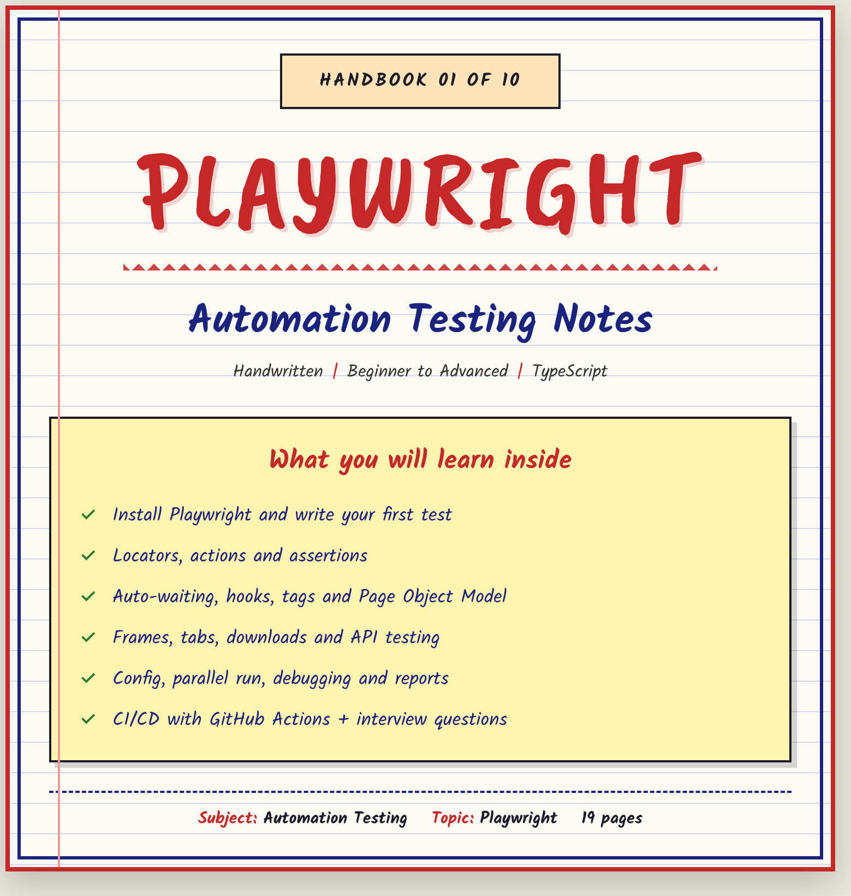

# PLAYWRIGHT

**HANDBOOK 01 of 10**

## Automation Testing Notes

Handwritten | Beginner to Advanced | TypeScript

---

## What you will learn inside

- Install Playwright and write your first test
- Locators, actions and assertions
- Auto-waiting, hooks, tags and Page Object Model
- Frames, tabs, downloads and API testing
- Config, parallel run, debugging and reports
- CI/CD with GitHub Actions + interview questions

---

Subject: Automation Testing | Topic: Playwright | 19 pages
