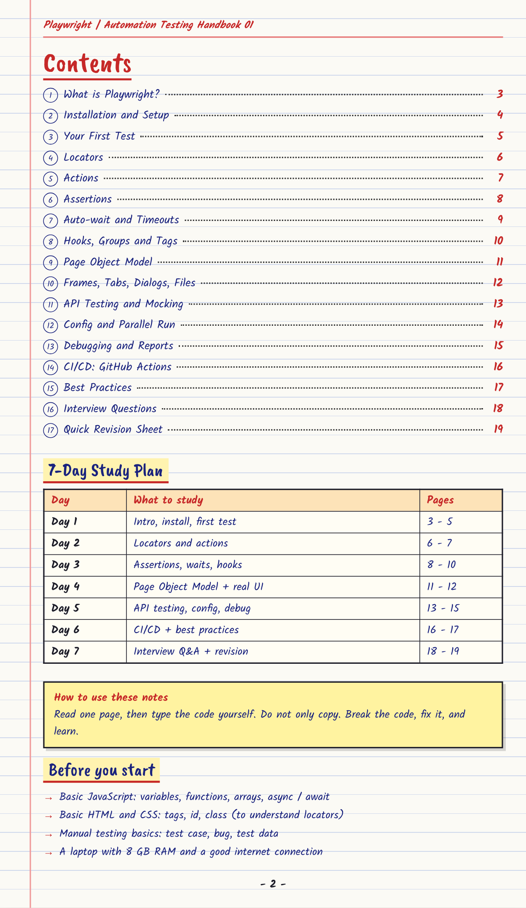

Text version (copy-paste friendly)

_Playwright | Automation Testing Handbook 01_

# Contents

1. What is Playwright? ........ 3
2. Installation and Setup ........ 4
3. Your First Test ........ 5
4. Locators ........ 6
5. Actions ........ 7
6. Assertions ........ 8
7. Auto-wait and Timeouts ........ 9
8. Hooks, Groups and Tags ........ 10
9. Page Object Model ........ 11
10. Frames, Tabs, Dialogs, Files ........ 12
11. API Testing and Mocking ........ 13
12. Config and Parallel Run ........ 14
13. Debugging and Reports ........ 15
14. CI/CD: GitHub Actions ........ 16
15. Best Practices ........ 17
16. Interview Questions ........ 18
17. Quick Revision Sheet ........ 19

## 7-Day Study Plan

| Day | What to study | Pages |
|---|---|---|
| Day 1 | Intro, install, first test | 3 - 5 |
| Day 2 | Locators and actions | 6 - 7 |
| Day 3 | Assertions, waits, hooks | 8 - 10 |
| Day 4 | Page Object Model + real UI | 11 - 12 |
| Day 5 | API testing, config, debug | 13 - 15 |
| Day 6 | CI/CD + best practices | 16 - 17 |
| Day 7 | Interview Q&A + revision | 18 - 19 |

> **How to use these notes**
> Read one page, then type the code yourself. Do not only copy. Break the code, fix it, and learn.

## Before you start

- Basic JavaScript: variables, functions, arrays, async / await
- Basic HTML and CSS: tags, id, class (to understand locators)
- Manual testing basics: test case, bug, test data
- A laptop with 8 GB RAM and a good internet connection

- 2 -

